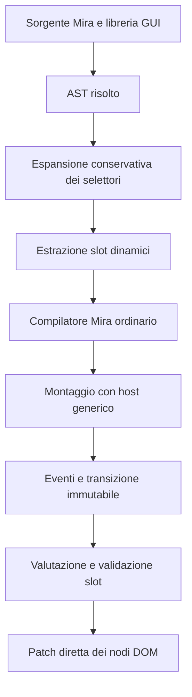

# Evoluzione del rendering GUI (Mira 0.15–0.22)

**Stato al 25 novembre 2026.** Rapporto storico, non specifica definitiva.

[Laboratory statico](https://spyryto.github.io/Mira/laboratory.html) · [DOM Performance Lab](https://spyryto.github.io/Mira/gui-benchmark.html) · [Dati completi e provenienza](../catalog/laboratory/gui-rendering.json) · [Interop browser](browser-interop.md)

## Obiettivo e decisioni

Mantenere la GUI una libreria sopra Mira, non un nuovo costrutto del linguaggio. Record e selettori descrivono la view; lo stato è un valore immutabile; la transizione produce il nuovo modello. Il browser host crea e aggiorna nodi DOM nativi. La specializzazione è un pass separato sull'AST risolto, non un secondo emitter o un framework. Il compilatore Mira continua a emettere JavaScript e PHP; PHP non esegue il DOM.

| Versione | Decisione | PR |
| --- | --- | --- |
| 0.15 | Libreria GUI, controlli e layout, ricostruzione del sottoalbero | [34](https://github.com/Spyryto/Mira/pull/34) |
| 0.16 | DOM incrementale, stato figlio indipendente, reset per chiave | [35](https://github.com/Spyryto/Mira/pull/35) |
| 0.17 | Decoratori di stile senza wrapper, griglia, validazione CSS | [36](https://github.com/Spyryto/Mira/pull/36) |
| 0.18 | Benchmark sul DOM reale | [37](https://github.com/Spyryto/Mira/pull/37) |
| 0.19 | Specializzazione di testi dinamici in view fisse; 0.17–0.19 integrate cumulativamente | [38](https://github.com/Spyryto/Mira/pull/38) |
| 0.20 | Stato record, condizioni e valori di stile dinamici | [39](https://github.com/Spyryto/Mira/pull/39) |
| 0.21 | Binding di input, checkbox, select statico, transizioni chiuse | [41](https://github.com/Spyryto/Mira/pull/41) |
| 0.22 | Componenti riutilizzabili, espansione lessicale e costanti letterali | [42](https://github.com/Spyryto/Mira/pull/42) |

## Architettura



Il renderer generico (`studio/ui-host.js`) prepara una view validata prima di applicare modifiche. Riconcilia per posizione e tipo, aggiorna callback, mantiene stato figlio quando il genitore cambia, e resetta se cambia la chiave dello state. Non implementa riordino per chiavi. Il pass specializzato (`studio/gui-specialize.js`) espande chiamate finite prima del montaggio, individua i percorsi dei nodi e ricompila gli slot tramite Mira. Durante l'aggiornamento non ricostruisce né attraversa l'intera view. Il codice di validazione CSS e gestione dei controlli è condiviso; gli input non vengono riscritti se il valore coincide e IME preserva il testo provvisorio. Una validazione fallita lascia lo stato e gli altri slot invariati, ripristinando il controllo.

### Esempio: componenti senza sintassi speciale

```mira
panel style = {padding: 16, radius: 14, gap: 8};
metric: caption, amount: number, tint: tone =
  styled: (column: [
    text: caption,
    title: number
  ]), with: [panel style, {background: tone}];

dashboard: count = column: [
  title: "Studio musicale",
  grid: 2, children: [
    metric: "Lezioni", amount: count, tint: "#c1f1dc",
    metric: "Compenso", amount: (count * 30), tint: "#ffdbab"
  ],
  button: "Nuova lezione", update: {old | old + 1}
];
```

La libreria reale è [lib/gui.mira](../lib/gui.mira). Le view originali [dashboard](../catalog/examples/gui-dashboard.mira) e [scheda lezione](../catalog/examples/gui-lesson.mira) sono fixture testate. Il laboratorio separa l'ultima chiamata a render per fornire il modello iniziale.

## Evidenze sperimentali

La fonte numerica canonica è il JSON collegato sopra: sei log CI (0.17–0.22) con versione, commit, job, mediane e P95 originali; due trascrizioni manuali dei risultati dell'autore 0.19 (iPhone e smart TV). Il rapporto statico Studio genera grafici e tabelle dai dati. Non sono stati rieseguiti per documentare. Le tabelle qui sotto evidenziano soltanto alcuni risultati.

### 0.17: DOM simulato

100 aggiornamenti di 103 elementi: allocazioni 10.300 → 0; scritture CSS 10.000 → 0; tempo 34,68 ms (ricostruzione) contro 44,67 ms (incrementale). L'incrementale evita operazioni DOM ma nel simulatore è più costoso. Da qui la scelta di misurare Chromium reale.

### 0.19: confronto su dispositivi

100 testi aggiornati, mediane in ms.

| Dispositivo e modalità | Ricostruzione | Incrementale | Specializzato | DOM diretto |
| --- | ---: | ---: | ---: | ---: |
| Chromium CI, sincrono | 0,297 | 0,103 | 0,027 | 0,023 |
| Chromium CI, layout | 0,670 | 0,480 | 0,417 | 0,410 |
| iPhone, sincrono | 0,333 | 0,133 | 0,033 | 0,033 |
| iPhone, layout | 2,067 | 1,400 | 1,233 | 1,267 |
| Smart TV, sincrono | 9,353 | 5,993 | 3,130 | 2,713 |
| Smart TV, layout | 39,570 | 28,947 | 26,290 | 25,967 |

Su TV il divario specializzato/diretto è +15,4% senza layout, +1,24% con layout. La costruzione della view è 0,257 ms; il layout forzato pesa molto di più. Le misure non sono additive. Modello e browser dei dispositivi non sono dichiarati; si vedono solo i due scenari densi.

### 0.20–0.22: stili e form

| Versione e carico | Modalità | Incrementale µs | Specializzato µs |
| --- | --- | ---: | ---: |
| 0.20 record e padding | Sincrono | 76,7 | 6,7 |
| 0.20 record e padding | Layout | 156,7 | 113,3 |
| 0.21 form | Sincrono | 60 | 10 |
| 0.21 form | Layout | 283,3 | 206,7 |
| 0.22 form con libreria | Sincrono | 40 | 6,7 |
| 0.22 form con libreria | Layout | 200 | 150 |

Il caso sparso 0.19 è circa 42× più rapido dell'incrementale senza layout, il caso denso circa 3,9×. Nel form 0.22 circa 6× senza layout e 1,33× con layout. Questi rapporti sono locali al rispettivo benchmark, non promesse di prestazioni generali.

### Metodo

5 campioni da 30 aggiornamenti, 5 warmup. Mediana e P95 delle medie per campione: con cinque campioni P95 equivale al massimo. Misura con e senza lettura geometrica forzata; non misura paint, FPS, memoria o latenza reale di digitazione. Compilazione, espansione e montaggio esclusi; il DOM diretto è codice specializzato scritto a mano. La sola view è una misura distinta. Timer e variabilità impediscono conclusioni statistiche da differenze minime, e un tempo zero indica risoluzione insufficiente. Gli eventi del form sono sintetici. IME è verificato in DOM simulato, focus e selezione in Chromium; non è stata verificata la tastiera iPhone. I confronti tra run diversi non sono benchmark di regressione controllati.

## Limiti e roadmap (proposte)

| Funzionalità | Generico | Specializzato 0.22 |
| --- | --- | --- |
| Testi, layout fissi, stili dinamici a forma fissa | Sì | Sì |
| Record, condizioni negli slot, controlli nativi | Sì | Sì |
| Componenti con selettori ordinari | Sì | Sottoinsieme finito e senza catture |
| Stato annidato | Sì | No |
| Strutture dinamiche e opzioni variabili | Sì (riconciliazione posizionale) | No |
| Selezione automatica del renderer nell'anteprima | Generico predefinito | No, opt-in nel Lab |

**Priorità proposta: rendering ibrido.** Specializzare i sottoalberi riconosciuti e mantenere il renderer generico per il resto; definire ownership, identità, confini di stato, transizioni e fallback coerenti prima di ampliare la specializzazione. Poi affrontare stato indipendente annidato, strutture condizionali/liste, closure con catture e opzioni dinamiche.

Altri esperimenti proposti: raggruppare gli aggiornamenti, mantenere Text node e modificare `Text.data`, CSS containment e `content-visibility` per limitare layout fuori viewport; misurare con più campioni e durata adattiva, includendo compilazione/espansione/montaggio, paint, memoria e frame. Nessuno di questi è ancora implementato come risultato di questo rapporto.

## Riproducibilità e CI

Bench → DOM Performance Lab esegue la versione corrente sul dispositivo. Laboratory è l'archivio statico generato da JSON, non esegue nuovi benchmark quando si apre. In locale: `npm run build:studio`, poi aprire `dist/studio/laboratory.html`; il benchmark GUI è in `dist/studio/gui-benchmark.html`. Le verifiche automatiche usano `test/benchmark-ui.test.mjs`, `test/ui-host.test.mjs` e `test/studio.test.mjs`. La 0.22 ha registrato 86 test Studio e 97 verifiche degli esempi, entrambe le CI verdi.

## Aggiornamento 0.23: primo esperimento ibrido

La roadmap sopra documenta lo stato storico della 0.22. La 0.23 introduce un esperimento a confini espliciti: selettori unari sorelli, classificazione per regione, owner dello stato condiviso, preparazione di tutte le regioni prima del commit, riconciliazione ordinaria del fallback. La partizione automatica e la specializzazione dello stato annidato restano da fare. Vedi [interop browser](browser-interop.md#mira-023-rendering-ibrido). Il dataset storico 0.15–0.22 resta immutato.

## Aggiornamento 0.24: riconoscimento automatico

La selezione avviene da un unico selettore unario. Specializzazione completa se possibile, partizione conservativa di una colonna radice con figli chiamati sullo stesso modello, altrimenti fallback generico. Il benchmark ibrido ora usa questa API. La partizione ricorsiva e l'integrazione nell'anteprima generale restano da progettare. Vedi [interop browser](browser-interop.md#mira-024-selezione-automatica-del-renderer).
