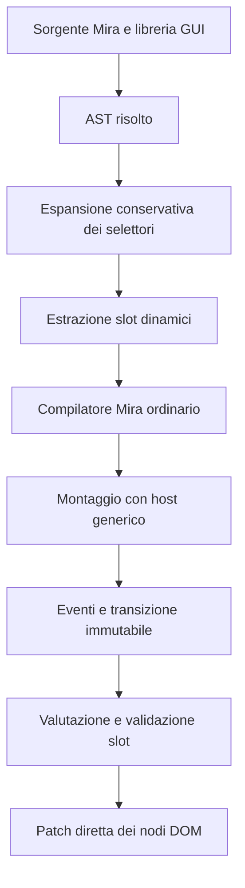

# Evoluzione del rendering GUI (Mira 0.15–0.28)

**Stato al 25 novembre 2026.** Rapporto storico, non specifica definitiva.

[Laboratory statico](https://spyryto.github.io/Mira/laboratory.html) · [DOM Performance Lab](https://spyryto.github.io/Mira/gui-benchmark.html) · [Dati completi e provenienza](../catalog/laboratory/gui-rendering.json) · [Interop browser](browser-interop.md)

## Obiettivo e decisioni

Mantenere la GUI una libreria sopra Mira, non un nuovo costrutto del linguaggio. Record e selettori descrivono la view; lo stato è un valore immutabile; la transizione produce il nuovo modello. Il browser host crea e aggiorna nodi DOM nativi. La specializzazione è un pass separato sull'AST risolto, non un secondo emitter o un framework. Il compilatore Mira continua a emettere JavaScript e PHP; PHP non esegue il DOM.

| Versione | Decisione | PR |
| --- | --- | --- |
| 0.15 | Libreria GUI, controlli e layout, ricostruzione del sottoalbero | [34](https://github.com/Spyryto/Mira/pull/34) |
| 0.16 | DOM incrementale, stato figlio indipendente, reset per chiave | [35](https://github.com/Spyryto/Mira/pull/35) |
| 0.17 | Decoratori di stile senza wrapper, griglia, validazione CSS | [36](https://github.com/Spyryto/Mira/pull/36) |
| 0.18 | Benchmark sul DOM reale | [37](https://github.com/Spyryto/Mira/pull/37) |
| 0.19 | Specializzazione di testi dinamici in view fisse; 0.17–0.19 integrate cumulativamente | [38](https://github.com/Spyryto/Mira/pull/38) |
| 0.20 | Stato record, condizioni e valori di stile dinamici | [39](https://github.com/Spyryto/Mira/pull/39) |
| 0.21 | Binding di input, checkbox, select statico, transizioni chiuse | [41](https://github.com/Spyryto/Mira/pull/41) |
| 0.22 | Componenti riutilizzabili, espansione lessicale e costanti letterali | [42](https://github.com/Spyryto/Mira/pull/42) |

## Architettura



Il renderer generico (`studio/ui-host.js`) prepara una view validata prima di applicare modifiche. Riconcilia per posizione e tipo, aggiorna callback, mantiene stato figlio quando il genitore cambia, e resetta se cambia la chiave dello state. Non implementa riordino per chiavi. Il pass specializzato (`studio/gui-specialize.js`) espande chiamate finite prima del montaggio, individua i percorsi dei nodi e ricompila gli slot tramite Mira. Durante l'aggiornamento non ricostruisce né attraversa l'intera view. Il codice di validazione CSS e gestione dei controlli è condiviso; gli input non vengono riscritti se il valore coincide e IME preserva il testo provvisorio. Una validazione fallita lascia lo stato e gli altri slot invariati, ripristinando il controllo.

### Esempio: componenti senza sintassi speciale

```mira
panel style = {padding: 16, radius: 14, gap: 8};
metric: caption, amount: number, tint: tone =
  styled: (column: [
    text: caption,
    title: number
  ]), with: [panel style, {background: tone}];

dashboard: count = column: [
  title: "Studio musicale",
  grid: 2, children: [
    metric: "Lezioni", amount: count, tint: "#c1f1dc",
    metric: "Compenso", amount: (count * 30), tint: "#ffdbab"
  ],
  button: "Nuova lezione", update: {old | old + 1}
];
```

La libreria reale è [lib/gui.mira](../lib/gui.mira). Le view originali [dashboard](../catalog/examples/gui-dashboard.mira) e [scheda lezione](../catalog/examples/gui-lesson.mira) sono fixture testate. Il laboratorio separa l'ultima chiamata a render per fornire il modello iniziale.

## Evidenze sperimentali

La fonte numerica canonica è il JSON collegato sopra: sei log CI (0.17–0.22) con versione, commit, job, mediane e P95 originali; due trascrizioni manuali dei risultati dell'autore 0.19 (iPhone e smart TV). Il rapporto statico Studio genera grafici e tabelle dai dati. Non sono stati rieseguiti per documentare. Le tabelle qui sotto evidenziano soltanto alcuni risultati.

### 0.17: DOM simulato

100 aggiornamenti di 103 elementi: allocazioni 10.300 → 0; scritture CSS 10.000 → 0; tempo 34,68 ms (ricostruzione) contro 44,67 ms (incrementale). L'incrementale evita operazioni DOM ma nel simulatore è più costoso. Da qui la scelta di misurare Chromium reale.

### 0.19: confronto su dispositivi

100 testi aggiornati, mediane in ms.

| Dispositivo e modalità | Ricostruzione | Incrementale | Specializzato | DOM diretto |
| --- | ---: | ---: | ---: | ---: |
| Chromium CI, sincrono | 0,297 | 0,103 | 0,027 | 0,023 |
| Chromium CI, layout | 0,670 | 0,480 | 0,417 | 0,410 |
| iPhone, sincrono | 0,333 | 0,133 | 0,033 | 0,033 |
| iPhone, layout | 2,067 | 1,400 | 1,233 | 1,267 |
| Smart TV, sincrono | 9,353 | 5,993 | 3,130 | 2,713 |
| Smart TV, layout | 39,570 | 28,947 | 26,290 | 25,967 |

Su TV il divario specializzato/diretto è +15,4% senza layout, +1,24% con layout. La costruzione della view è 0,257 ms; il layout forzato pesa molto di più. Le misure non sono additive. Modello e browser dei dispositivi non sono dichiarati; si vedono solo i due scenari densi.

### 0.20–0.22: stili e form

| Versione e carico | Modalità | Incrementale µs | Specializzato µs |
| --- | --- | ---: | ---: |
| 0.20 record e padding | Sincrono | 76,7 | 6,7 |
| 0.20 record e padding | Layout | 156,7 | 113,3 |
| 0.21 form | Sincrono | 60 | 10 |
| 0.21 form | Layout | 283,3 | 206,7 |
| 0.22 form con libreria | Sincrono | 40 | 6,7 |
| 0.22 form con libreria | Layout | 200 | 150 |

Il caso sparso 0.19 è circa 42× più rapido dell'incrementale senza layout, il caso denso circa 3,9×. Nel form 0.22 circa 6× senza layout e 1,33× con layout. Questi rapporti sono locali al rispettivo benchmark, non promesse di prestazioni generali.

### Metodo

5 campioni da 30 aggiornamenti, 5 warmup. Mediana e P95 delle medie per campione: con cinque campioni P95 equivale al massimo. Misura con e senza lettura geometrica forzata; non misura paint, FPS, memoria o latenza reale di digitazione. Compilazione, espansione e montaggio esclusi; il DOM diretto è codice specializzato scritto a mano. La sola view è una misura distinta. Timer e variabilità impediscono conclusioni statistiche da differenze minime, e un tempo zero indica risoluzione insufficiente. Gli eventi del form sono sintetici. IME è verificato in DOM simulato, focus e selezione in Chromium; non è stata verificata la tastiera iPhone. I confronti tra run diversi non sono benchmark di regressione controllati.

## Limiti e roadmap (proposte)

| Funzionalità | Generico | Specializzato 0.22 |
| --- | --- | --- |
| Testi, layout fissi, stili dinamici a forma fissa | Sì | Sì |
| Record, condizioni negli slot, controlli nativi | Sì | Sì |
| Componenti con selettori ordinari | Sì | Sottoinsieme finito e senza catture |
| Stato annidato | Sì | No |
| Strutture dinamiche e opzioni variabili | Sì (riconciliazione posizionale) | No |
| Selezione automatica del renderer nell'anteprima | Generico predefinito | No, opt-in nel Lab |

**Priorità proposta: rendering ibrido.** Specializzare i sottoalberi riconosciuti e mantenere il renderer generico per il resto; definire ownership, identità, confini di stato, transizioni e fallback coerenti prima di ampliare la specializzazione. Poi affrontare stato indipendente annidato, strutture condizionali/liste, closure con catture e opzioni dinamiche.

Altri esperimenti proposti: raggruppare gli aggiornamenti, mantenere Text node e modificare `Text.data`, CSS containment e `content-visibility` per limitare layout fuori viewport; misurare con più campioni e durata adattiva, includendo compilazione/espansione/montaggio, paint, memoria e frame. Nessuno di questi è ancora implementato come risultato di questo rapporto.

## Riproducibilità e CI

Bench → DOM Performance Lab esegue la versione corrente sul dispositivo. Laboratory è l'archivio statico generato da JSON, non esegue nuovi benchmark quando si apre. In locale: `npm run build:studio`, poi aprire `dist/studio/laboratory.html`; il benchmark GUI è in `dist/studio/gui-benchmark.html`. Le verifiche automatiche usano `test/benchmark-ui.test.mjs`, `test/ui-host.test.mjs` e `test/studio.test.mjs`. La 0.22 ha registrato 86 test Studio e 97 verifiche degli esempi, entrambe le CI verdi.

## Aggiornamento 0.23: primo esperimento ibrido

La roadmap sopra documenta lo stato storico della 0.22. La 0.23 introduce un esperimento a confini espliciti: selettori unari sorelli, classificazione per regione, owner dello stato condiviso, preparazione di tutte le regioni prima del commit, riconciliazione ordinaria del fallback. La partizione automatica e la specializzazione dello stato annidato restano da fare. Vedi [interop browser](browser-interop.md#mira-023-rendering-ibrido). Il dataset storico conserva i risultati precedenti e viene esteso con i nuovi log.

## Aggiornamento 0.24: riconoscimento automatico

La selezione avviene da un unico selettore unario. Specializzazione completa se possibile, partizione conservativa di una colonna radice con figli chiamati sullo stesso modello, altrimenti fallback generico. Il benchmark ibrido ora usa questa API. La partizione ricorsiva e l'integrazione nell'anteprima generale restano da progettare. Vedi [interop browser](browser-interop.md#mira-024-selezione-automatica-del-renderer).

## Aggiornamento 0.25: anteprima e ispettore

La selezione automatica è disponibile nell'anteprima ordinaria per render finali riconoscibili; il pannello espone regioni, slot e motivi di fallback, tempi di preparazione e montaggio. La modalità generica resta selezionabile. Nessun cambiamento di grammatica. Vedi [interop browser](browser-interop.md#mira-025-anteprima-e-ispettore).

## Archivio CI aggiornato: 0.23–0.25

I log originali dei job 139391850171, 139399014945, 139404483141 sono archiviati integralmente come risultati strutturati nel JSON. Mediane in µs, cinque campioni da trenta aggiornamenti; costi iniziali esclusi.

| Versione | Sincrono incrementale | Sincrono ibrido | Layout incrementale | Layout ibrido |
| --- | ---: | ---: | ---: | ---: |
| 0.23.0 | 43.3 | 6.7 | 296.7 | 276.7 |
| 0.24.0 | 50.0 | 6.7 | 506.7 | 456.7 |
| 0.25.0 | 70.0 | 10.0 | 490.0 | 453.3 |

Il confronto è interno a ciascun run, non una regressione controllata tra versioni. La 0.25 misura preparazione e montaggio nell'ispettore, ma non archivia ancora questi tempi. Il prossimo esperimento è Text.data; nessuna adozione automatica prima di misure comparabili.

## Aggiornamento 0.26: Text node persistenti

Esperimento isolato: confronto textContent / Text.data per gli stessi slot del renderer specializzato. La variante persistente è opt-in nel benchmark, non adottata nella preview. Si verifica identità, valori vuoti e sicurezza del testo. Vedi [interop browser](browser-interop.md#mira-026-text-node-persistenti).

## Aggiornamento 0.27: raggruppamento dei commit

Esperimento opt-in per soli slot testuali. Transizioni e validazione immediate, commit eventualmente differito; confronta microtask e rAF sul vero event loop, conteggi di commit/scritture e latenza. Nessuna adozione predefinita. Vedi [interop](browser-interop.md#mira-027-raggruppamento-dei-commit).

## Archivio 0.26–0.27

Aggiunti i log originali dei job 139409972419, 139425561403 e tutti i risultati strutturati, incluse mediane/P95 dei nodi testuali e dei commit accorpati. La 0.27 conferma, su sette raffiche dense da dieci eventi, 7000 → 700 scritture; dal primo evento al commit finale, 0,6 ms immediato, 0,2 ms microtask, 15,1 ms rAF. Il renderer predefinito rimane immediato.

## Aggiornamento 0.28: CSS containment

Confronto isolato su 256 testi e pannelli a dimensione fissa: normale, contain layout paint e content-visibility auto. Aggiornamenti di tutti i testi o soltanto della regione lontana; misura anche il costo di rivelare il pannello dopo lo scroll. Nessuna modifica alla preview. Vedi [interop](browser-interop.md#mira-028-css-containment).

## Archivio 0.28 e aggiornamento 0.29

Il log CI 139433834245 aggiunge i risultati completi di containment. Mediane update/layout visibile: tutti i testi 1,340 / 1,180 / 0,165 ms (normale/contain/auto); solo lontani 0,115 / 0,120 / 0,005 ms. Reveal auto 0,2 e 0,4 ms. Il 0,29 applica sperimentalmente content-visibility alle sole schede statiche del Laboratory ad altezza variabile, con fallback CSS e checkbox di confronto. Vedi [Studio](studio.md#laboratory-layout-differito-029).

## Archivio aggiornato fino alla 0.34

Recuperati i rapporti strutturati dei sei job PWA integrati (0.29–0.34), con tutti i casi browser, form, ibridi, Text.data, batching, containment e Laboratory reale. L'archivio contiene 18 rapporti CI e 244 scenari (uno scenario è una combinazione di carico/modalità di prova con più strategie confrontate, oppure un viewport del Laboratory), più quattro scenari su due dispositivi dell'autore. I report ripetuti nelle release di linguaggio non rappresentano una serie di regressioni controllate. Link a job e commit in JSON e Laboratory. Nessun risultato ricalcolato.

### Laboratory reale: primo esperimento 0.29

7 campioni da 10 variazioni di larghezza. Schede statiche reali (51) e dettagli (14). Mediana e P95, ms:

| Viewport | Layout normale | Layout differito | Reveal normale | Reveal differito |
| --- | ---: | ---: | ---: | ---: |
| 390 px | 1,440 / 1,750 | 0,480 / 0,520 | 0,100 / 0,200 | 0,200 / 0,300 |
| 800 px | 1,550 / 2,010 | 0,450 / 0,470 | 0,100 / 0,200 | 0,200 / 0,200 |

| Viewport | Stima iniziale | Dopo visita | Normale | Dopo toggle | Dopo nuova visita |
| --- | ---: | ---: | ---: | ---: | ---: |
| 390 px | 19906 | 21294 | 21294 | 19883 | 21294 |
| 800 px | 18515 | 17797 | 17797 | 18515 | 17797 |

L'altezza è in px; in entrambi i casi il contenuto lontano risulta saltato. Il layout differito riduce il costo misurato di circa 3× / 3,44×, non il tempo complessivo di paint; il reveal ha un costo aggiuntivo. Le due CI fallite prima del merge hanno evidenziato perdita della stima al toggle e problemi del runner Chromium (chiusura profilo e attesa documento). La versione integrata verifica la riacquisizione delle dimensioni. [Job 139440393387](https://github.com/Spyryto/Mira/actions/runs/45680764254/job/139440393387).

La 0.30–0.34 sposta la priorità dalle prestazioni alle applicazioni. La 0.33 aggiunge identità per chiave nel renderer generico, con focus/caret verificati in Chromium su percorso nativo e fallback; la 0.34 usa il renderer generico nel registro persistente. Nessun benchmark mirato alla performance delle collezioni o delle liste keyed, nessuna misura nuova su iPhone/TV. Punto di pareggio, paint, memoria e specializzazione più ampia sono rinviati. Vedi [decisioni](decisions.md#stato-e-direzione-034).

## Mira 0.92 — GUI checked

Il checker attribuisce ai costruttori della libreria standard il tipo
fantasma opaco interno `#GUI.View (State)`: non esiste un nuovo record,
tag o helper di tipo nel codice emesso. Il tipo del modello è condiviso
fra i figli di un layout e le transizioni; uno state annidato introduce
un modello indipendente. Il render standard non ha un proprietario di
stato: una transizione direttamente sotto il render viene rifiutata.

```mira
import "lib/gui.mira";
counter: n = column: [
  text: n,
  button: "+1", update: {old | old + 1}
];
render (state: 0, view: (counter: _));
```

Il pulsante GUI checked di Studio passa il sorgente al checker Haxe prima
di eseguire l'anteprima. Anche CLI --check e --checked utilizzano la stessa
ABI. La firma di input/select richiede Text e una funzione (State, Text)
-> State; checkbox richiede Boolean e (State, Boolean) -> State; button
update richiede State -> State. Un componente rimane una normale funzione.

Decisione provvisoria: la libreria GUI esistente usa record eterogenei
e il checker non ha un tipo unione di record con rappresentazione
nativa. Per evitare wrapper o una seconda libreria runtime, la piccola
ABI è associata solo all'esatto sorgente standard (SHA-256), importato
come lib/gui.mira o concatenato all'inizio del sorgente come nel catalogo.
Una libreria diversa non acquisisce le firme speciali. Le firme sono
fidate e testate, non dedotte dai corpi dei costruttori. Quando il sistema
di tipi permetterà di dichiarare la rappresentazione opaca eterogenea
in Mira, rivalutare questo confine.

Limiti: decoratori con liste di record di stile eterogenei non sono
ancora checked; proprietà CSS, appartenenza di un valore alle opzioni,
chiavi duplicate o non valide, range delle colonne e rappresentabilità
dello stato a runtime restano controlli host. I callback on click checked
sono nullari; altre funzioni host richiedono firme esplicite. Il render
standard non tipizzato riceve la firma speciale solo con la libreria
verificata; una firma host esplicita resta responsabilità dell'host.
Il codice PHP dei descrittori si può generare, ma non esegue il DOM.
Il rendering non viene modificato da questa fase; le prestazioni
devono essere misurate separatamente se si modificano gli updater.


## Mira 0.93 — Checked style layers (candidata)

Nel costruttore standard verificato `styled: view, with: layers`, una lista letterale di stili viene controllata contestualmente: ciascun elemento deve avere una rappresentazione record, ma le righe non devono essere identiche.

```mira
import "lib/gui.mira";
render (styled: (text: "Mira"), with: [{padding: 12}, {background: "#fff", radius: 4}]);
```

Non cambia l'inferenza delle liste ordinarie, la libreria GUI, il renderer o gli emitter. Il controllo contestuale è limitato alle chiamate dirette alla primitiva verificata: liste memorizzate, sezioni e liste generate seguono ancora l'inferenza omogenea. Nomi di proprietà CSS e vincoli dei valori rimangono responsabilità dell'host. I test verificano anche che JS e PHP emessi siano identici alla compilazione non checked.


## Mira 0.94 — Style safety (candidata)

Il controllo contestuale delle liste letterali passate direttamente a `styled:with:` della GUI verificata riconosce il vocabolario esistente di `studio/ui-host.js`. Rifiuta proprietà sconosciute, tipi incompatibili e valori letterali non ammessi. Esempi: padding numerico da 0 a 4096, fontWeight intero da 100 a 900, width numerico oppure "fill"/"auto", colori esadecimali o "transparent"/"currentColor", align nelle opzioni supportate. Anche un fatto numerico puntuale già disponibile nell'analisi può evidenziare una violazione. Un parametro numerico inferito non dimostra il suo intervallo.

La tabella compile-time in GuiStyleRules riproduce il piccolo vocabolario host senza modificare renderer o emitter. I test di concordanza verificano compilazione JS/PHP, equivalenza dell'output nei casi accettati e comportamento del renderer. La duplicazione è provvisoria: se il vocabolario cresce, valutare una singola specifica generativa.

Limiti espliciti: non è una prova generale di validità CSS; righe aperte, valori calcolati non dimostrati, variabili di dimensione (Number o Text) non risolte e liste di stili non letterali mantengono i controlli host. Nessun nuovo controllo a runtime, nessuna eliminazione delle guardie host. L'anteprima checked resta opt-in.
